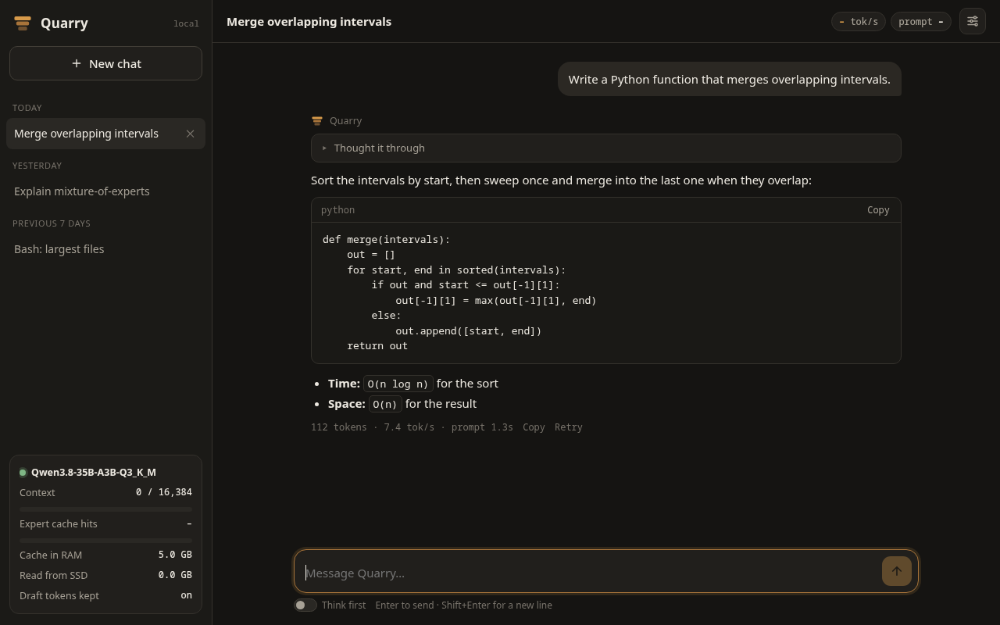
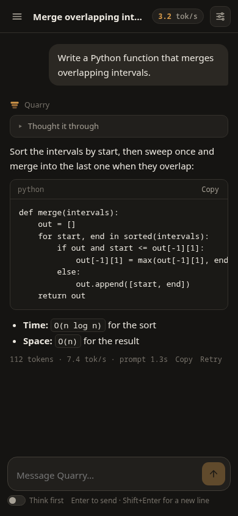

# Quarry

CPU-only inference for Mixture-of-Experts models that are **bigger than your RAM**.

Strata-style engines split a MoE model between GPU and RAM. Quarry does the same
between **RAM and SSD**: the dense weights stay in RAM, and the experts are streamed
from the SSD into an expert cache. Each layer's router is applied one layer early to
predict which experts come next, and they're prefetched while the current layer computes.

It serves an OpenAI-compatible API with streaming and tool calling, so coding agents
such as [opencode](https://opencode.ai) can use it.

## Results

All numbers are from a laptop with an i3-1005G1 (2 cores / 4 threads, AVX-512 VNNI),
**11GB RAM** (~22GB/s) and an NVMe SSD. The models don't fit in RAM.

### Qwen3-Coder-30B-A3B-Instruct (Q3_K_S, 13.3GB)

| engine | generation tok/s |
|---|---|
| llama.cpp (mmap, page cache warm) | 3.75 |
| Quarry, exact (`--experts 8`) | ~7.0-7.3 |
| **Quarry, default** (6 of 8 experts per token) | **~7.5-7.9** |

Run-to-run variation on this laptop is about ±10%.

Coding quality, greedy, HumanEval (every 8th task, 21 tasks, executed against the tests):

| experts per token | passed | avg time per task (prompt + answer) |
|---|---|---|
| 8 (exact model) | 19/21 | 44s |
| **6 (default)** | **19/21** | **34s** |
| 5 | 18/21 | 37s |

- exact mode matches llama.cpp logits (cosine 0.998, same top token)
- expert cache hit rate ~93% when a layer starts, next-layer prediction accuracy ~82%
- prompt processing: ~26 tok/s on a 1511-token prompt (batched, 512 tokens at a time)

### Qwen3.8-35B-A3B-Distill (Q3_K_M, 17.7GB, `qwen35moe`)

Qwen3.6-style hybrid: 30 Gated DeltaNet layers + 10 gated attention layers, 256 experts.

| | |
|---|---|
| generation, short context (default: all 8 experts, MTP speculation, 5GB cache) | ~5.5-6.9 tok/s |
| generation without speculation (`QUARRY_NO_SPEC=1`) | ~6.6-6.8 tok/s |
| generation, `--experts 6` (faster, lossy) | ~6.2-7.6 tok/s |
| generation at 12.6K context | ~4.6 tok/s |
| prompt processing | ~32 tok/s (4K tokens) |
| HumanEval subset (21 tasks), 6 experts / 8 experts | **20/21** (45s/task) / 20/21 (52s/task) |

- logits match llama.cpp (cosine 0.998, same top token), token by token and batched
- 6 experts per token was the default until it sent the model into a "..." loop on a short
  chat turn that the full model answers normally; Qwen3.5/3.6/3.8 now run all 8
- opencode end to end (write a file, run it): first turn 10 min (12.6K-token prompt),
  later turns reuse the cached prefix (~3s of prompt processing)
- speculative decoding with the model's own MTP layer: it drafts one token, and the main model
  verifies two tokens per pass (weight rows unpacked once for both tokens). ~90% of drafts are
  accepted on code; greedy output is unchanged, sampling uses the standard speculative rule.
  HumanEval subset with speculation: 20/21, 44s/task
- thinking is off by default; `--think` or `"chat_template_kwargs": {"enable_thinking": true}`
- the output layer (248K vocab) runs from a 4-bit copy that picks 64 candidates, whose exact
  logits are computed from the file's rows (`QUARRY_EXACT_OUTPUT=1` keeps the full matrix in RAM)

### Images (Qwen3.5/3.6)

Put the model's vision encoder (`mmproj*.gguf`, e.g. the 0.9GB BF16 one from the model's GGUF
repo) next to the model, or pass `--mmproj`. Images go in OpenAI-style `image_url` parts
(base64 data URLs); the chat page has an attach button, and paste and drag-and-drop work.

- the encoder runs through llama.cpp's libmtmd on the CPU: ~10s for a 256-token image
  (`QUARRY_IMAGE_TOKENS`, default 256), then ~20s to read it into the model
- image tokens get Qwen's interleaved 3D (M-RoPE) positions
- follow-up questions reuse the processed image (4s instead of 28s)

### Mellum 2.1 12B-A2.5B Thinking (Q4_0, 7.0GB, `mellum`)

JetBrains' coding MoE: 28 attention layers (3 of every 4 with a 1024-token sliding window, the
others with YaRN RoPE), 64 experts, 8 used.

| setup | Quarry | llama.cpp |
|---|---|---|
| whole model fits in RAM | 8.6 tok/s | 9.2 tok/s |
| 4GB memory limit (an 8GB laptop with a browser open) | **7.2 tok/s** | 3.5 tok/s (mmap; default settings are killed for running out of memory) |
| 1.5GB expert cache | 4.2 tok/s | |
| prompt processing (2465 tokens) | 34.8 tok/s | |

- logits match llama.cpp (cosine 0.9999, same top token), on a 2465-token prompt as well,
  token by token and batched
- tool calls in Mellum's JSON format, thinking on request
- the 4GB rows use a cgroup limit (`systemd-run --user --scope -p MemoryMax=4G`), with the model
  file evicted from the page cache first

### Inkling 2 Mini (Q4_K_M, 18.7GB, `inkling2_loop`)

| engine | generation tok/s |
|---|---|
| llama.cpp (`llama-bench tg32`) | 0.34 |
| **Quarry** (6.5GB cache) | **2.14** (6.3x) |
| Quarry `--skip 0.1` (lossy) | 2.72 |

Logits match llama.cpp (cosine 0.9998, same top token); every one of its 48 layer slots
matches at cosine >= 0.997.

## Install

```sh
git clone https://github.com/randomdevtom/quarry && cd quarry
./install.sh
```

The installer:

1. checks the CPU (AVX-512 VNNI), RAM and build tools, and prints the package command if any are missing
2. builds llama.cpp's tokenizer library (pinned, tested version) and Quarry, and links `~/.local/bin/quarry`
3. downloads the default model (Qwen3.8-35B-A3B Distill, Q3_K_M, 17.7GB), or uses `--model your.gguf`
4. sizes the expert cache to your RAM and writes `~/.config/quarry/quarry.env`
5. runs Quarry as a systemd user service (starts at login), serving the chat page and the API on port 8090
6. optionally shares the chat on your Tailscale tailnet (`tailscale serve`, HTTPS, tailnet only)
7. optionally adds Quarry as a provider in opencode

`./install.sh --yes` takes the defaults without asking. Other options: `--port`, `--ctx`,
`--cache GB`, `--models-dir`, `--no-service`, `--tailscale`, `--opencode`. `./install.sh --uninstall`
removes the service, config and link (models and the build stay).

To build by hand instead: gcc with AVX-512 VNNI and OpenMP, plus libllama (tokenizer only;
`vendor/llama.cpp` is used when built), then `cd quarry && make`.

## Chat

Open http://127.0.0.1:8090/ once the server runs. Streaming replies, optional thinking
(shown live in a collapsible box), code blocks with copy, chat history kept in the browser,
and an engine panel: context used, expert cache hit rate, SSD reads, draft acceptance and
live tok/s. Works on a phone, light and dark.

<p> </p>

## Use

```sh
# chat in the terminal
QUARRY_CACHE_GB=6.5 ./build/quarry run -m Qwen3-Coder-30B-A3B-Instruct-Q3_K_S.gguf

# OpenAI-compatible server: streaming, tool calls, prompt-prefix reuse across turns
QUARRY_CACHE_GB=6.0 ./build/quarry serve -m model.gguf --port 8090 -c 32768
# -> chat page at http://127.0.0.1:8090/, API at /v1/chat/completions, engine stats at /v1/stats

# installed as a service: edit ~/.config/quarry/quarry.env, then
systemctl --user restart quarry
```

Options:

- `QUARRY_CACHE_GB`: expert cache size. Use most of your free RAM minus the dense
  weights (~0.9GB for Qwen3-Coder) and the KV cache (fp16, ~100KB per token of context).
- `--experts N`: experts per token (default 6 of 8 for Qwen3-Coder, all 8 for the rest; fewer is faster and lossy).
- `QUARRY_PF_T`: prompt chunk size (default 2048). Bigger chunks read the experts from the SSD
  fewer times per prompt and use more RAM (~170MB per 1024 tokens).
- `-c N`: context length (default 4096). Memory is only used as the context fills.
- `--skip 0.1` (Inkling, lossy): skip an expert that isn't in RAM when it has under 10%
  of the routing weight.
- `--effort 0..0.99` (Inkling): thinking effort, default 0.2.

### opencode

`./install.sh --opencode` adds this for you. By hand, add a provider to `~/.config/opencode/opencode.json`:

```json
{
  "provider": {
    "quarry": {
      "npm": "@ai-sdk/openai-compatible",
      "name": "Quarry (local)",
      "options": { "baseURL": "http://127.0.0.1:8090/v1" },
      "models": {
        "quarry": { "name": "Qwen3-Coder 30B (Quarry)", "tool_call": true,
                    "limit": { "context": 32768, "output": 4096 } }
      }
    }
  }
}
```

Then pick `quarry/quarry` as the model. Tool definitions, tool calls and tool results are
rendered in Qwen3-Coder's own format (`<tool_call><function=...>`) and parsed back into
OpenAI `tool_calls`. opencode's first request is large (system prompt plus tool
definitions, ~13K tokens), so the first turn of a session takes several minutes on a
laptop like this one. Later turns reuse the cached prefix and only process what's new.

## How it works

- `src/experts.c`: the expert cache. Slots are evicted LRU, with one size class per expert
  size so mixed-quant models waste no RAM. Reads use O_DIRECT (Quarry, not the page
  cache, decides what stays in RAM) and Linux AIO, so an expert's gate/up/down parts
  load in parallel. Demand loads jump the queue, prefetches go last, and experts in use
  are pinned.
- `src/model.c`: qwen3moe forward pass. Experts already in RAM are computed as one batch
  while missing ones load. The router is kept as bf16 (the file's F32 values are exact
  bf16), the KV cache is fp16. Prompts are processed in 512-token batches: each weight row
  is repacked once to int8 and reused for every token with VNNI `dpbusd`, tokens are
  grouped by expert so each expert is read once per batch, and attention runs as small
  matrix multiplies over a transposed K.
- `src/qwen35.c`: Qwen3.5/3.6 MoE forward pass (gated delta net with a 128x128 state per
  head, gated attention, shared expert). The recurrent state can't be rewound, so it is
  snapshotted at the end of each prompt for prefix reuse.
- `src/inkling.c`: Inkling 2 forward pass (looped layers, block-residual mixing,
  relative-position attention with sinks, short convolutions, sigmoid-routed MoE).
- `src/quants.c`: Q3_K, Q4_K, Q5_K, Q6_K, Q4_0, Q4_1, Q5_0 and Q8_0 kernels (AVX-512 VNNI),
  checked against gguf-py. Q3_K matvec reaches ~21GB/s on 2 cores, close to RAM speed.
- `src/qgguf.c`: GGUF reader. Dense tensors are loaded into RAM, experts are addressed
  by file offset.
- `src/main.c`: CLI and HTTP server (chat templates, tool calling, streaming).

`RESEARCH.md` has the measurements, the routing-trace and cache-simulation work behind
the design, and what didn't help. `research/code_bench2.py` runs HumanEval, HumanEval+
and MBPP against a running server.

## Limits

- architectures: qwen3moe, qwen35moe (Qwen3.5/3.6 MoE text), mellum, inkling2_loop
- x86-64 with AVX-512 VNNI only (Ice Lake or newer, Zen 4 or newer)
- one sequence at a time; batched prompt processing for Qwen3-Coder (Q3_K weights) and
  Qwen3.5/3.6 (Q3_K-Q6_K); Inkling runs token by token
- the tokenizer comes from libllama (vocab-only load)

## License

MIT
